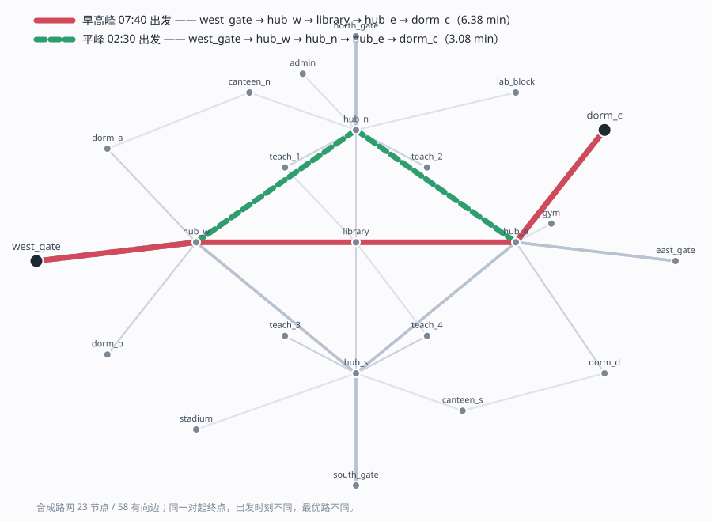

# campus-bus-routing

[](https://github.com/LUOaini1213/campus-bus-routing/actions/workflows/ci.yml)

**In one paragraph (EN)** — a time-dependent shortest-path stack for a campus shuttle:
a 23-node / 58-directed-edge graph whose edge weights change by time of day, a binary-heap
time-dependent Dijkstra checked against A\*, a label-correcting reference *and* brute-force
enumeration, bursty GPS dropout with map-matched isotonic reconstruction, four congestion
predictors judged on two different yardsticks with paired bootstrap intervals, and a
zero-dependency HTTP service. Every table below is regenerated by a committed script and
checked in CI. **Three of the seven findings are corrections of my own earlier claims** —
they are kept, with the mistake stated, because that is the part worth reading.

分时（time-dependent）校园班车路由：23 节点 / 58 有向边的动态加权图，二叉堆
Dijkstra 与 A\*，GPS 成串丢点补偿，四个拥堵预测器的对照，以及一个零依赖的
HTTP 服务。**每个结论都对应 `results/` 里一份可复跑的产物，README 的数字由
`scripts/check_readme.py` 回算校验。**

---

## Provenance —— 先读这一节

**这是 2026 年 9 月重建的实现，不是 2024 年那份课程作业的原件。**

我在 2024 年 9 月至 12 月做过一个同名的校园巴士调度优化，简历里引用过它的
数字（路径求解准确率 98.7%、高峰通勤时间降 27.8%、对比 A\* 提升 11.2 个百分点、
车辆数 12 降至 10、Docker 响应 < 50 ms、GPS 信号丢失约 15%）。**那份代码、
数据与报告都没有留档**，本机与网盘都找不到。所以：

- **本仓不复现那些数字，也不试图证明它们。** 它们来自真实的校内北斗轨迹，
  数据没了就是没了。要引用只能说「2024 年课程实践的结果，原始记录未留存」。
- **本仓重建的是方法与可核验性**：同样的图规模、同样的算法路线，把「怎么做的、
  怎么验的、代价多大」变成能跑的代码和能查的数。面试里被追问「98.7% 的分母是
  什么」「50 ms 是怎么测的」时，答案在这里。
- **路网是合成的**（`scripts/build_network.py` 一条命令确定性生成，CI 校验
  字节级可重建），拓扑按常见校园布置构造，不是长安大学的真实路网。
- **速度历史也是合成的**（日周期 + 随机事件 + 噪声），不是真实观测。

下面所有数字都是在这份合成数据上、在这台机器上跑出来的，`results/` 里有原文。

---

## 30 秒跑通

```bash
pip install -r requirements.txt
python scripts/build_network.py          # 生成 network/campus_graph.json
python -m unittest discover -s tests -v  # 37 个测试
python scripts/check_readme.py           # README 的 62 个数字逐个回算
python bench/bench_all.py                # 四组测量 -> results/bench.json
python -m campus_bus.service --port 8080 # 起服务
curl "http://127.0.0.1:8080/route?from=west_gate&to=dorm_c&depart=470"
```

```json
{"from": "west_gate", "to": "dorm_c", "depart_min": 470.0, "arrival_min": 476.03,
 "travel_min": 6.029, "path": ["west_gate", "hub_w", "library", "hub_e", "dorm_c"],
 "expansions": 20, "solver": "dijkstra", "solve_ms": 0.0271}
```

同一对起终点，凌晨 2:30 出发走的是另一条路（`hub_n` 而不是 `library`）——
分时权重不是摆设，它真的会换路：



（`python scripts/draw_network.py` 重画，手写 SVG 无第三方依赖，CI 校验可重建。）

---

## 七个结论，每条都有产物

### 1. 分时权重到底值多少：不是"平均快多少"，是"不在任何时段犯大错"

这是整个仓最该先回答、我却最后才补上的问题。如果拿自由流速度选出来的路和
拿分时速度选出来的路是同一条，那这套分时机制就是白做的。

四种策略的区别只在**选路时看到什么边权**，结算一律放回真实分时路网走一遍，
比的是**实现行程时间**（不是选路时以为的行程时间——后者是自欺欺人）：

| 选路时看到的 | 高峰多付 | 高峰最差 | 高峰选错路 | 平峰多付 | 平峰最差 | 平峰选错路 |
|---|---|---|---|---|---|---|
| 只看限速 free_flow | 1.7323% | 24.0126% | 46/300 | **0%** | 0% | 0/300 |
| 全天均速 daily_mean | 1.7323% | 24.0126% | 46/300 | **0%** | 0% | 0/300 |
| 高峰档当常数 peak_profile | 0.3440% | 15.8470% | 18/300 | 4.3887% | **49.0847%** | 60/300 |
| **按时刻查 time_dep** | **0%** | **0%** | **0/300** | **0%** | **0%** | **0/300** |

**每个静态近似都在某个时段是对的、在另一个时段错得很厉害。**只看限速的策略
平峰完全正确（平峰本来就是自由流），高峰却有 46 条路选错、最差一趟多花 24%；
把高峰档当全天常数的策略反过来，高峰还行，**平峰最差多花 49.0847%**。

所以分时的价值不是"平均省了 x%"——平均值只有 1.7%，写进简历会显得很弱。
真正的价值是**最坏情况**：单趟最多能差 24%~49%，而且你事先不知道今天这趟会不会撞上。
原始简历里那个"高峰通勤时间降 27.8%"是什么口径我已经说不清了，本仓不引用它。

**这张表在 8 个随机种子上都成立。**换种子重建整张路网（`bench/bench_robustness.py`）：
高峰 free_flow 多付 **1.28%–1.73%**、最差 **18.1%–27.5%**、选错路 **44–53/300**；
平峰 free_flow **恒为 0**（8/8 个种子）；平峰 peak_profile 最差 **27.6%–56.5%**。
数值随种子变，**方向一次都没变**——`tests/test_all.py::Robustness` 把方向写成了断言。

**一个必须承认的局限：`free_flow` 与 `daily_mean` 两行逐字节相同。**这不是巧合，
是生成器的产物——拥堵因子只按道路等级分三档，边间差异仅有相位与 σ=0.02 的扰动，
所以 `daily_mean/free_flow` 的比值在同一等级内离散度只有 0.004，选路时对同类边
完全保序，必然选出同一条路。**真实路网上这两行会分开**，这是本表最不可外推的一格。

### 2. 「FIFO 违反数为 0」是采样分辨率的产物——我原来的论证是错的

分时图上 Dijkstra 仍然最优，**条件是 FIFO（先进先出 / 非超车）**：`t1 < t2`
必须推出 `t1 + tt(e,t1) ≤ t2 + tt(e,t2)`——晚出发不可能早到。

`check_fifo()` 在本网上返回 **0** 条违反。我据此写过一句：「最坏单边行程 2.56 min
小于 5 min 槽宽，**结构上就不可能违反**」。**这句话是错的**，而且五行脚本就能证伪：
按槽边界前后各取一点直接比到达时刻，16646 个槽边界里有 **8324** 个（50.0%）
是下降的——连续意义上的 FIFO 被违反了一半。`check_fifo` 看不见，只是因为它的默认
采样步长是 2.5 min，而最大下降 **0.3145** min 远小于它。

**槽宽决定的是采样器的盲区，不是剖面的性质。** 正确的说法是：分段常速剖面在槽
边界上几乎必然违反连续 FIFO；真正让 Dijkstra 可用的不是"违反数为 0"，而是
**违反的幅度有上界**——次优性被 `max_boundary_drop()` = 0.3145 min 界住，
而实测 600/600 与参照实现一致。

8 个种子上这个故事完全一样：采样违反恒为 0、连续违反恒在 8286–8365 之间、
最大下降 0.3145–0.5665 min 恒小于 2.5 min 的采样步长。**「结构上不可能」在任何一个
种子上都不对。**

所以 `check_fifo` 的语义被我在 docstring 里重新写死了：它回答的是「在 step 分辨率
下是否可见」，不是「是否存在」。`build_network.py` 现在把两个数一起打出来。

**而 FIFO 一旦真的被违反，代价是数量级的，见下一条。**

### 3. 正确性靠的是第二个求解器——但它有一个盲区，我花了三轮才看见

`routing.py` 里有四个求解器：堆 Dijkstra、A\*、标签修正参照实现，以及穷举。
bench 拿参照实现当答案，在 **600** 次查询（60 组 OD × 10 个出发时刻，覆盖早晚高峰
与平峰）上比对：

| | 最优率 | 平均展开节点 |
|---|---|---|
| Dijkstra | **600/600** | 12.09 |
| A\* | **600/600** | **6.95** |
| 上界剪枝 | **600/600** | 9.62 |
| 标签修正（参照） | — | 23 |

A\* 少展开 **42.48%**，上界剪枝省下 **20.41%**，答案都一模一样。每次查询还额外校验
「沿返回的路径真走一遍，到达时刻等于返回的标签」——路径与标签必须自洽。

再加一道**第三方**：把某个时刻的速度冻住做成静态图，交给
`networkx.dijkstra_path_length` 独立求一遍，三个时刻全部逐一相等。

**但这三道验证有一个共同的盲区。** 构造一个违反 FIFO 的 4 节点网（`a→c` 有快慢两条、
`c→b` 早进极慢晚进极快），结果是：

| | 到达时刻 | 路径 |
|---|---|---|
| Dijkstra | 61.000 min | `a→c→b` |
| 标签修正（"参照答案"） | 61.000 min | `a→c→b` |
| **穷举（真值）** | **23.000 min** | **`a→d→c→b`** |

**两个求解器一起错了 38 分钟，而且互相印证不出来**——因为它们共享同一个假设
（每个节点只保留最早标签）。`enforce_fifo()` 之后三者一致。networkx 那道也帮不上忙：
它只覆盖静态快照。

所以「参照实现校验的是堆与松弛逻辑，不是建模前提」这句话得写在明处。
`brute_force()` 是仓里唯一不假设 FIFO 的真值来源，`test_both_solvers_fail_together_without_fifo`
把这个反例锁住了。

### 4. 「动态松弛阈值」这个消融是无效的——不是结论无效，是实验设计无效

原设计里有一个动态松弛阈值：改进小于阈值就不松弛，用一点最优性换展开数。
我跑了三个数量级、写了一整节"它不划算"，**然后发现它在数学上就不可能划算**。

阈值加在松弛条件 `arr < cur - thr` 上，而一个节点**首次**被发现时 `cur = INF`，
`INF - thr` 仍是 INF——它永远挡不住首次入堆。展开数的下界恒等于可达节点数，
与阈值取值无关。

| 阈值 (min) | 最优率 | 平均展开 |
|---|---|---|
| **0（默认）** | **100.0%** | 12.83 |
| 0.25 | 94.58% | 12.82 |
| 1.0 | 92.92% | 12.79 |
| **1e9（彻底退化）** | — | **12.79** |

把阈值开到 **1e9**（等于让算法退化成"首次看到的标签即终值"）展开仍是 **12.79**,
和 1.0 一模一样。一个真优化不会这样；`scaling.json` 里甚至出现过**负的**节省。

**真正能减少展开的近似加在别处。** 上界剪枝——当 `arr + h(v) ≥ 已知的 dst 最优到达`
时不入堆——省下 **20.41%** 的展开，因为 h 可采纳，**最优率仍是 600/600**。
这才是那一节本来该有的样子。8 个种子上剪枝省下 **19.9%–20.9%** 且**恒无损**，
而阈值即使开到 1e9 也从没省下超过 **0.49%**。

### 5. 一个被自己的模拟器骗过去的结论，以及改对之后的四条

**这一节的第一版结论是错的，而且错在最难发现的地方：模拟器。**

第一版让车在每条边上匀速直线行驶，于是"按时间线性插值"在数学上就是精确的
——测出 15% 丢失率下误差 0.00 m，我据此写下"补偿没救回什么"。那不是关于现实的
发现，是关于我自己模拟器的发现。真实公交至少有三件事不满足那个前提：

1. **进站停靠**——到站停 18 s，这段时间位置不动，插值会把车"插着穿过"停靠；
2. **加减速**——边内用 smoothstep 推进，位移不是时间的线性函数；
3. **GPS 有测量噪声**——单轴 σ = 6 m，于是**连保留下来的点都不是真值**。

第 3 条最关键：噪声一来，"地图匹配"才有了存在的理由。改对之后（435 个采样点、
36 个停站点，原始观测平均误差 **7.262 m**）：

| 丢失率 | 最长连丢 | | 保留点 mean | 丢失点 mean | 丢失点 p95 |
|---|---|---|---|---|---|
| 5% | 15 点 | 朴素插值 | 7.246 m | 6.588 m | 10.078 m |
| | | **匹配+弧长** | **3.342 m** | **5.158 m** | 9.151 m |
| 15% | 26 点 | 朴素插值 | 7.359 m | 7.276 m | **14.137 m** |
| | | **匹配+弧长** | **3.475 m** | **6.734 m** | 16.035 m |
| 30% | 26 点 | 朴素插值 | 7.233 m | 6.823 m | **14.088 m** |
| | | **匹配+弧长** | **3.424 m** | **5.437 m** | 15.545 m |

四条结论：

- **地图匹配把观测点误差砍掉一半以上**（7.36 → 3.48 m）。这是投影消掉横向噪声的
  直接收益，与丢不丢点无关——**第一版完全看不到这一层，因为它没有噪声。**
- **丢失点的均值也降了**（三档都降），但 **p95 反而略差**。两种方法都不知道车在
  停站：弧长插值仍在匀速推进，而真车停着不动。这是残留缺陷，照实写，没修。
- 单调约束**不能用 `np.maximum.accumulate`**。累积最大值只会抬高、从不下调，把对称
  噪声整流成**系统性前偏**。换成**保序回归**（PAVA）后保留点从 4.80 m 再降到 3.48 m。
  `test_isotonic_beats_cumulative_max` 锁住这个对照。
- **贪心地图匹配会把点永久锁死在错误的边上。** 投影原本只在"当前边及其之后"里找，
  且指针只增不减；6 m 噪声在路口足以把一个点投到下一条边，此后再也回不来——实测
  15% 丢失率下有 **12%** 的观测点被锁错。现在允许回退一格，既挡住乱跳（全图找最近边
  会跳到反向边，误差比不做还大 100 倍），又给噪声一次改正机会。

### 6. 我把这一节的结论说反过一次，因为结算真值用错了

四个拥堵预测器（预测未来 15 分钟的边速度），**评在同一批 113,274 个样本上**。
两把尺子：速度 MAE，以及**实现行程时间的多付比例**（拿预测速度选出的路，放回
真实速度里走一遍）。

**先说我改了什么。** 第一版结算用的是**基础剖面** `net.speed`，而预测器预测的是
`hist[-1]`（基础剖面 × 当日系数 + 随机事件 + 噪声）——**两者不是同一个量**。后果是
一个完美预测第 20 天的 oracle 也会有非零多付，而输出越平滑、越接近基础剖面的模型
越占便宜。当时我的头条结论是"MAE 最好的 ridge 不是选路最好的"，而那**相当一部分
是这个口径错配造成的**。把结算真值改成被预测的那一天、出发时刻从只覆盖早高峰的
5 个扩到全天 10 个（样本 150 → 300）之后：

| 模型 | MAE (km/h) | 多付行程时间 | 与最好者的差（配对自助 95% CI） | 有分歧的配对 |
|---|---|---|---|---|
| persistence（下一步=这一步） | 1.4472 | 0.3151% | +0.2797 pp **[0.1167, 0.4722] 显著** | 18/300 |
| seasonal（昨天同刻） | **2.0659（最差）** | 0.1014% | +0.066 pp [-0.0105, 0.1914] 不显著 | 6/300 |
| ridge（滞后特征 + 时刻） | **1.2007（最好）** | 0.05% | +0.0146 pp [0.0, 0.0394] 不显著 | 3/300 |
| LSTM（单层，32 隐单元） | 1.2979 | 0.0354% | —（名义最好） | — |

**ridge 的 MAE 最好；选路上名义最好的是 LSTM。** 两者只差 **+0.0146 pp**，配对自助的
95% CI **[0.0, 0.0394]** 跨 0，300 个配对里只有 **3** 个有分歧——这个实验分不出它们。
所以原来那句「MAE 最好的不是选路最好的」，在修正后的口径下同样没有证据支撑：不是
被反证，而是这个实验区分不了。还站得住的是更弱、也更有意思的一句：**seasonal 的
MAE 比 ridge 差 72%，在选路上却分不出来。**

**"不显著"必须连着功效一起说。** 300 个配对里只有 **6** 个让 seasonal 与最好者
分道扬镳，ridge 更只有 3 个。这么小的 k，自助重抽有可观概率一个都没抽到，
CI 下界会**恰好等于 0.0**——那是离散性伪影，不是"效应接近 0"的估计。
所以正确的说法不是"三者等价"，而是**这个实验没有区分它们的功效**。
`test_the_routing_ranking_must_not_be_over_read` 把"必须报 `n_differing`"写进了测试。

配对自助用的是 `campus_bus/stats.py` 的**纯标准库**实现（`random.Random`），
不是 numpy——`Generator` 的流跨大版本不承诺稳定（NEP 19），公开仓的 CI 装最新
numpy，把 BLAS 与随机流从被校验的数字里拿掉，比事后 debug 便宜得多。

（LSTM 那一行要 torch，CI 不装，结果由本机跑出后提交在
`results/bench_with_lstm.json`；不带 LSTM 的三行在 `results/bench.json`，CI 每次校验。）

### 7. 23 节点证明不了「二叉堆优化到 O(|E|+|V|log|V|)」，所以另外测

原始简历写「用二叉堆把复杂度优化到 O(|E| + |V| log |V|)」。这句话在 23 节点上
**无法证伪**——总共才展开十来个节点，用列表线性扫一样快。所以把同一套代码
放到确定性生成的网格路网上，把「堆」这一个变量单独隔离出来测
（`dijkstra_linear` 是同一个算法但用 O(V) 线性扫描找最小标签）：

| 节点 | 边 | 堆版 | 线性扫描 | 堆的加速 | A* 省下展开 | 阈值 0.25 省下 / 最优 |
|---|---|---|---|---|---|---|
| 100 | 360 | 0.13 ms | 0.20 ms | 1.56× | 20.0% | −0.1% / 5-12 |
| 400 | 1,520 | 0.39 ms | 1.13 ms | 2.91× | 26.8% | −0.1% / 7-12 |
| 1,600 | 6,240 | 1.48 ms | 10.5 ms | 7.07× | 26.8% | −0.5% / 4-12 |
| 4,900 | 19,320 | 5.82 ms | 99.0 ms | **17.03×** | 38.3% | −0.3% / 1-12 |
| 10,000 | 39,600 | 13.1 ms | 太慢未测 | — | 35.6% | +0.7% / 1-12 |

（最后一列 "省下 / 最优" 指展开节点省下的比例与 12 组查询里仍最优的次数。）

三个结论：**堆的收益随规模从 1.56× 长到 17×**，在 23 节点上确实可以忽略——
这句简历话在原场景里其实没有支撑，放到万级节点上才成立；**A\* 的收益也随规模
上升**（20% → 38%）且始终保持最优；**松弛阈值在任何规模上都不划算**。

`python bench/bench_scaling.py`，结果在 `results/scaling.json`。网格路网只用于
这一节的规模对照，不参与其它任何结论。

---

## 关于「Docker 部署响应 < 50 ms」

服务用标准库 `http.server`，**运行镜像不装任何第三方包**（`Network.load`
在没有 numpy 时自动退回纯 Python 列表，CI 里专门卸掉 numpy 跑一遍验证）。
本机 HTTP 端到端往返（含 socket、JSON 编解码与服务端求解）：

| 并发 | 连接 | p50 | p95 | p99 | max |
|---|---|---|---|---|---|
| 1 | 复用 | 0.26 ms | 0.35 ms | **0.44 ms** | 0.99 ms |
| 16 | 复用 | 3.57 ms | 6.79 ms | **17.7 ms** | 513 ms |
| 16 | 每请求新建 | 3.51 ms | 4.91 ms | **515 ms** | 1027 ms |

`< 50 ms` 在前两行成立（p99 分别是 0.44 ms 与 17.7 ms），第三行**不成立**：
每请求新建 TCP 连接时 p99 是 515 ms，比复用连接差 **29 倍**。差别全在连接
建立，不在求解——求解本身 p99 只有 **0.035 ms**（见 `results/bench.json`，
比 HTTP 往返小两三个数量级）。

两点值得说：**一是「< 50 ms」这种指标必须连测法一起讲**，同一份代码在这三
行里既成立也不成立；**二是 p50 会骗人**，第三行的 p50 只有 3.5 ms，比第一
行还好看，尾部却已经到秒级。复用连接那行的 max 也有一个 513 ms 的孤点，
单次、未复现、原因未查——照实留着。

```bash
docker build -t campus-bus .
docker run --rm -p 8080:8080 campus-bus
```

---

## 关于「车辆数 12 降至 10」

车队规模是天花板函数：`ceil((环线运行时间 + 折返停留) / 发车间隔)`，所以
**它是一级一级掉的，不随提速连续下降**。本网那条覆盖全校的班车环线，早高峰
运行 26.81 min、间隔 4 min、折返 3 min：

| 周期时间降幅 | 周期 (min) | 车辆数 |
|---|---|---|
| 0% | 26.81 | **8** |
| 7% | 24.93 | 7 |
| 22% | 20.91 | 6 |
| 37% | 16.89 | 5 |

少一辆车需要周期时间降 **6.75%**——降 6% 一辆不少，降 7% 少一辆。所以
「行程时间降 x%」和「少几辆车」不是一回事，必须分别交代。`campus_bus/fleet.py`
+ `tests/test_all.py::Fleet` 把这个关系锁住。

---

## 仓库里有什么 / 没有什么

```
campus_bus/network.py     分时图、FIFO 检查与修复
campus_bus/routing.py     堆 Dijkstra / A* / 标签修正参照实现
campus_bus/gps.py         成串丢点模拟、地图匹配、两种补偿
campus_bus/congestion.py  四个预测器 + 两把尺子
campus_bus/policies.py    四种「选路时看到什么」的策略对照
campus_bus/fleet.py       车队规模的天花板函数与台阶
campus_bus/service.py     零依赖 HTTP 服务
scripts/build_network.py  确定性生成路网（CI 校验字节级可重建）
bench/bench_all.py        四组测量，--check 比对已提交结果
bench/bench_service.py    HTTP 端到端延迟
campus_bus/stats.py       纯标准库的配对自助（不用 numpy，跨机器逐位一致）
bench/bench_scaling.py    100 ~ 10,000 节点的规模对照
bench/bench_robustness.py 8 个随机种子的稳健性扫描
bench/od_pairs.json       固化的 OD 对（让结论不依赖 numpy Generator 的流稳定性）
scripts/check_readme.py   把 README 里每个数字回算一遍
scripts/draw_network.py   手写 SVG 路网图
tests/test_all.py         37 个测试（含 networkx 第三方交叉校验、非 FIFO 反例、跨种子不变量）
results/                  上面每张表的原始 JSON
NOTICE.md                 合成数据声明与第三方依赖许可证
```

| 仓里有 | 仓里没有 |
|---|---|
| 合成的 23 节点 / 58 边分时路网，一条命令确定性重建 | 真实校园路网、真实北斗轨迹 |
| 四个求解器（堆 Dijkstra / A\* / 标签修正 / 穷举）与 600 次交叉验证 | 2024 年那份课程作业的原始代码与报告 |
| GPS 成串丢点 + 6 m 噪声的模拟与两种补偿 | 任何真实接收机的原始数据 |
| 四个拥堵预测器、两把尺子、配对自助置信区间 | 任何形式的实车或路侧验证 |
| 8 个随机种子的稳健性扫描 | 多于一张合成网的外部效度 |
| 37 个测试、CI、零依赖运行镜像 | 生产规模的负载与可用性证据 |

---

## 诚实边界

1. **全部结论都在合成数据上**，不可外推到真实路网。最不可外推的一格是
   `free_flow` 与 `daily_mean` 逐字节相同——那是生成器只按道路等级分三档造成的。
2. **预测器那一节的实验功效不足**：300 个配对里只有 3–6 个让模型分道扬镳，
   "不显著"应读作"这个实验分不出来"，不是"已证明等价"。
3. **两档 GPS 估计器都不知道车在停站**，丢失点 p95 因此劣于朴素插值。
   这是残留缺陷，没修。
4. **延迟数字只对本机有意义**，不参与任何跨机器比对。
5. **本仓有三条结论是我自己先前说法的更正**（FIFO 的论证、松弛阈值的消融设计、
   预测器那节的结算口径），更正连同错法一起留在文里。
6. 一句话：**可以说**「重建了一套分时路由与评测，把方法和代价量清楚了」；
   **不可以说**「复现了 2024 年那次课程实践的结果」。
